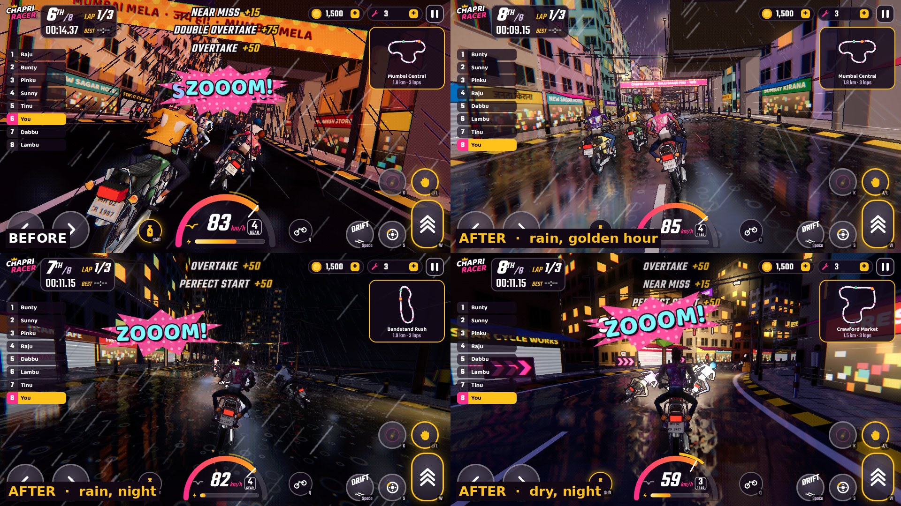
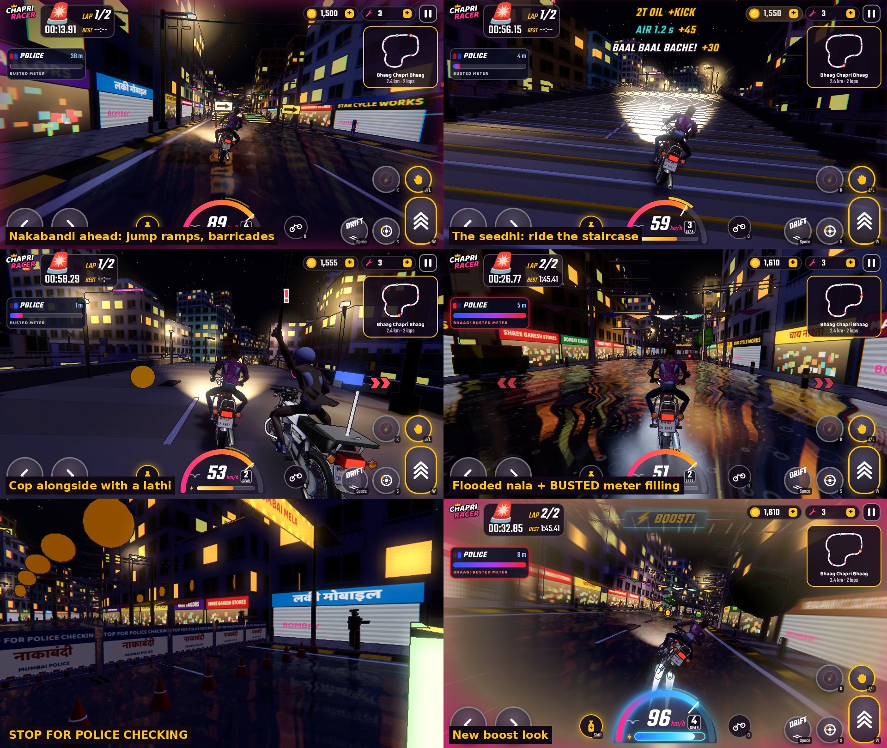
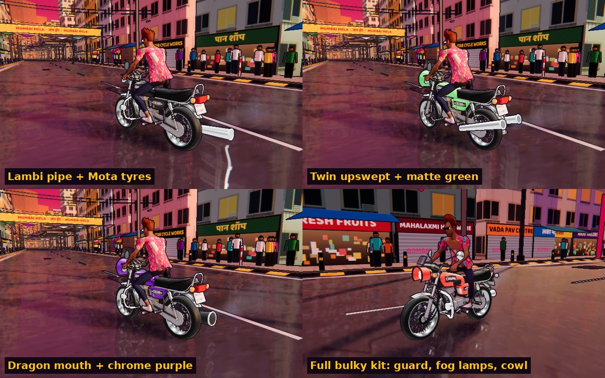

# Chapri Racer

A browser bike-racing game built with Three.js. You ride CR100 two-strokes (RX-style bikes, rebadged) through Mumbai's underbelly: a metro station, Andheri Tunnel, an LED hairpin, the docks, a broken bridge and a salt-pan dirt road, plus lanes, flyovers, markets and Dharavi rooftops. Races have eight riders, plus street fights, jumps, monsoon rain and a comic-book look.



## Play

Open `dist/chapri-racer.html` in a desktop or mobile browser. It's a single self-contained file, but it needs an internet connection for the three.js CDN and the Google Fonts. Touch controls appear on phones. On a keyboard:

| Key | Action |
| --- | --- |
| W / ↑ | Throttle |
| S / ↓ | Brake |
| A D / ← → | Lean |
| Space | Drift |
| Shift | Boost |
| Q | Hop (tap) / wheelie (hold) |
| J / L | Hit |
| K | Throw / spit / shoot |
| C | Camera |
| P / Esc | Pause |

## What's in it

- **Mumbai Underground (the main map).** A 2.1 km night run under a storm sky, two laps by default. Each section gets a title card the first time you reach it.
  - **Andheri Metro:** the grid starts under a metro station that straddles the road. A trial-run train shuttles out along the viaduct to a launching gantry and rumbles overhead.
  - **Andheri Tunnel:** sodium light strips that sweep over the bike, jet fans, lane signals, an engine echo, honking traffic you weave through, and a burst water main you ride through (CHHAPAAK!, water on the lens).
  - **Subway Cut and LED Hairpin:** graffiti retaining walls, two overbridges, then a hairpin lined with a scrolling pink and cyan chevron wall.
  - **Dock 7:** container stacks, ship-to-shore cranes with moving trolleys, floodlight towers, black water and a berthed ship.
  - **Adhoora Pul:** the unfinished metro bridge. Hit the tin lip and jump the gap in slow motion (UDAAN!) under a tower crane, or fall in.
  - **Namak Khet:** a salt-pan kachha road with dust, fences, pylons, floodlight poles, ground fog and a broken-down HORN OK PLEASE truck.
  - **Lokhandwala:** market neon and chasing festoon bulbs back to the finish.
  - Shaving past traffic scores a PEEP PEEP! near miss.
- **Rival taunts.** On every track, rivals now and then shout Hinglish lines in speech bubbles when they pass you, when you pass them, or when you hit them.
- **Controls.** Steering answers at once: the bike starts sliding toward the side you press while the heading catches up. On touch, the two arrows act as one pad, so you can slide your thumb across. Tap weight-back (Q) to hop over slicks, glass and potholes; hold it for a wheelie in any gear. A wheelie is also a speed trick (more pull, a higher top speed, less steering).
- **Fights.**
  - Hits freeze for a few frames on contact (hit-stop), with a lens punch, a swing arc of light, impact flashes and sparks.
  - New weapons: the saria (iron rod, heavy hits, metal sparks) and the katta (a country pistol with 4 shots that bursts tyres; at speed a blowout throws the rider down the road).
  - Gutka now also leaves a red slick on the road behind you. Whoever rides through it slides.
  - Takedowns: a crashed bike tumbles and bounces with sparks while the rider rolls down the road on his own. When you cause it (or go down yourself), the camera cuts to a slow-motion takedown shot, then back to the race.
- **Sting boost.** Boost comes from glowing Sting cans on the road; the rider chugs one and tosses it. Boosting floods the screen neon cyan and pink, tints the sky light violet, throws electric sparks and arcs off the silencer and leaves light trails.
- **Nitro gates.** Every track has nitro strips under a neon gate with a tall light beacon, so you can line up from far away.
- **Direction guide.** A chevron ribbon on the road follows the racing line: green to go, amber to lift, red to brake. A card at the top shows the next sharp corner or hairpin and the distance and side of the next nitro. It can be turned off in Settings.
- **Traffic.** Autos, kaali-peeli taxis, BEST buses and tempos on every track except Dharavi's lanes. Set Off, Light or Jam in Settings.
- **Street life.** Pani puri and bhel carts, vada pav and chai tapris, ganne-ka-ras crushers, roadside shrines, BEST bus stops, plants and white-and-red painted tree trunks, each stall lit by its own bulb. There are no people.
- **Look.** A colour grade that lifts night shadows into violet and pushes saturation, brighter night lighting and more street lamps, neon rim lights and an underglow on your bike, and thick two-stroke smoke with backfire flames.
- **Police Express+.** A solo escape mode on its own night stage, **Bhaag Chapri Bhaag**.
  - Finish 2 laps before the BUSTED meter fills. Police bikes with sirens and lathis chase you.
  - Nakabandi checkpoints have full-width barricades. You can jump the big yellow ramps or smash through.
  - Riflemen telegraph each shot with a red laser, so you can swerve to dodge.
  - The stage also has a long staircase to ride up and down, a flooded nala, and stray dogs that dash across.
- **Five more tracks.** Mumbai Central, Crawford Market, Dharavi Lanes, Bandstand Rush and Sion Flyover. Hazards include potholes, kichad (mud), triple speed-breakers and kachha shortcut lanes. The Championship runs all six.
- **Set pieces:**
  - plank ramps over autos and carts, with coin arcs;
  - ride-through market and parking halls;
  - a Dharavi rooftop run with gaps to jump;
  - a local train crossing under the Sion flyover.
- **Monsoon rain.** Turn it on with the home-screen button or in Race Setup. The road becomes a rippled mirror, grip drops and bikes slide.
- **Graphics:**
  - planar wet-road reflections and glow on lamps and neon (Medium and High quality);
  - the comic-book post effect: ink outlines, halftone and pop-up sound words;
  - time-of-day moods.
- **Ride feel.**
  - Road-relative steering assist: left/right sets where the bike points off the road, and it follows the curve when you let go. It can be turned off in Settings.
  - Walls are glancing hits with sparks, bikes lean on each other instead of sticking, and breakers become small hops at speed.
  - A spring-rigged chase camera that swings into turns, slides on lane changes and dips on landings and gear shifts.
  - Motion-blurred wheels, monsoon tyre spray, wind-blown drops on the lens, and tyre scrub / squeal / wet-hiss sounds.
- **Rider swagger.** On calm straights the rider smokes, combs his pompadour, twirls his moustache, dips his shades, scratches his head or throws a two-finger salute. He looks back after overtakes, and shakes a fist at whoever hits him. The Rider smokes switch in Settings turns smoking off.
- **Winner's entry.** Win a race (or escape the police) and the bike power-slides to the kerb in slow motion. The rider kills the engine, swings off, lights up behind a cupped hand and walks at the camera while FIRST! slams in. Tap to skip.
- **Riders.** Skinned riders with IK posing and a verlet-cloth open shirt over a baniyan. The default rider has an athletic build, a sculpted brown pompadour, gold aviators, stubble, gold chains and a watch, and a tropical hibiscus shirt. Hair moves in the wind. The home screen uses studio rim lights, and the profile picture is a live portrait of your rider.
- **Boost.** A "⚡ BOOST!" banner, an electric-blue speedometer with a BOOST bar, blue exhaust jets, neon speed lines and radial blur.
- **Garage.** Builds, performance upgrades, 18 paints, and visual mods:
  - silencers: lambi pipe, twin upswept, or dragon mouth (fire on boost);
  - Mota or racing tyres;
  - crash guard with fog lamps, café cowl, or the full bulky kit;
  - gloss, matte, metal-flake or chrome finish.
- **Music.** Original music generated live with Web Audio, in two styles you pick in Settings:
  - South mass (default): parai and thavil koothu grooves, a nadaswaram hook, brass and guitar stabs, theatre whistles and crowd "HEY!"s, plus a hero-entry theme for the winner.
  - Dhinchak DJ: dhol, tabla and a tumbi riff.
  The intensity follows the race.





### URL options

| Option | Effect |
| --- | --- |
| `?q=low\|medium\|high` | Force a quality tier |
| `?refl=0` | No road reflections |
| `?post=0` | No glow or comic pass |
| `?comic=0` | Glow without the comic look |
| `?bike=basic` | Built-in primitive bike instead of the GLB |
| `?rider=basic` | Built-in primitive rider instead of the GLB |
| `?autopilot&track=dharavi-lanes&weather=monsoon&time=night&laps=1` | Watch an AI-driven race |
| `?autopilot&mode=police&nobust` | Watch a Police Express+ run that can't end in an arrest |
| `?autopilot&entry=1` | Let an autopilot win play the winner's entry |

## Build

```bash
npm install
npm run build        # src/ + assets/*.glb  ->  dist/chapri-racer.html
```

`tools/build.mjs` concatenates `src/js/*.js` in a fixed order into one ES module and inlines `src/style.css`. It also embeds both GLB models as gzip + base64 into `src/template.html`.

### Source layout (`src/js`)

| File | What it does |
| --- | --- |
| `00_core` | Config, builds, upgrades, mods, save data, stats |
| `05_textures` | Procedural canvas textures |
| `10_tracks`, `15_track` | Track definitions; centreline, widths, elevation, hazards, shortcuts, set pieces, racing line |
| `18_batch`, `20_world`, `21_stage`, `22_underground`, `23_street` | Batched city geometry: roads, buildings, halls, rooftops, railway, sky, lighting, moods; stage pieces (staircase, nala, nakabandi, festive lights); the Mumbai Underground set pieces (metro, tunnel, cut, LED hairpin, docks, broken bridge, salt pans, market neon); stalls, shrines, bus stops and nitro gates on every track |
| `28_bikemodel`, `30_bike`, `32_bikemods` | Bike GLB loading, paint and finishes, rig, visual mods |
| `29_ridermodel`, `31_cloth`, `40_rider` | Skinned rider and IK, shirt cloth, rider physics and AI |
| `45_race`, `46_police`, `47_underground`, `48_street`, `50_combat` | Race flow, scoring, coins, style-move scheduling; stage runtime (barricades, dogs, water) and Police Express+ (cops, busted meter, riflemen); Underground runtime (burst main, UDAAN slow-mo, metro rumble, tunnel echo, section cards) and rival taunts; traffic, nitro, the direction guide and the boost look on every track; weapons, gutka slicks, the katta, wrecks, particles, tyre spray |
| `55_speedfx`, `56_reflect`, `57_comic`, `58_entry` | Speed lines and lens rain; wet-road mirror; glow and comic post pass; the winner's entry cutscene |
| `60_audio`, `62_music` | Engine and SFX synthesis; procedural music |
| `70_hud`, `80_ui`, `85_input`, `90_main` | HUD, menus, garage, input, game loop and camera |

### Asset pipeline (`tools/model`)

- `build-model.mjs`, `rebadge.py`, `paintmask.py`: turn the source bike into the rebadged, paint-masked `assets/rx100.glb` with a rival LOD.
- `build-rider.mjs`, `paint-rider.py`: slim the base character, paint the clothes, and add the hair and flutter attributes. Output is `assets/rider.glb`.

### Headless tests (`tools/t*.mjs`)

These use Playwright Chromium. Run `npx playwright install chromium` once, then run them from the repo root after `npm run build`. Screenshots land in `tools/` and are git-ignored.

```bash
node tools/t17.mjs mumbai-underground 2                      # fast-forward a full race, report errors and crashes
node tools/t31.mjs dharavi-lanes 2                           # jumps, rooftop falls, coins and crash spots
node tools/t32.mjs look sion-flyover golden monsoon 10       # in-race screenshot
node tools/t33.mjs                                           # garage close-ups of mod combinations
node tools/t36.mjs                                           # fast-forward a Police Express+ run: escaped or busted
node tools/t37.mjs                                           # Police Express+ screenshots: checkpoint, stairs, water, boost
node tools/t40.mjs                                           # feel audit: keyboard steering vs AI, contacts, wobble, camera jerk
```

## Friends rooms (multiplayer)

Race friends on phones or laptops with a 4-digit PIN. No sign-up, no accounts.

- **Create a room:** Friends, then Play with friends, enter a name, and tap CREATE A ROOM. Share the PIN, or tap COPY LINK (it copies `/?room=PIN`).
- **Join a room:** Friends, type the PIN and tap JOIN. Opening an invite link does the same thing.
- **Race:** the host picks the track, laps, time and weather. START RACE needs at least two racers. Everyone sees the others as ghost bikes and gets the same results.
- **Progress** stays on each device (browser storage). A friends race pays the same coins and XP as a Quick Race.

### Run the room server

    npm install
    npm run server

`npm run server` builds `dist/chapri-racer.html` and serves the game at `/`, the socket at `/socket.io` and a health check at `/healthz`, on `PORT` (default 8080). On a public host, put it behind HTTPS and WSS, and set `ALLOWED_ORIGINS` when the page is served from another origin. The environment variables and deployment notes are in `server/README.md`. Nothing here is deployed for you.

### Tests

    npm test               # unit tests, server tests and the solo golden trajectories
    npm run test:server    # room server only (fast)
    npm run test:race      # solo smoke test (headless browser)
    npm run test:e2e       # browser end-to-end: lobby, friends race, progress (about 25 minutes on a 4-core machine)
    npm run test:all       # everything above

### Known limits

- Each device runs its own physics. The server keeps the lobby, the start time, the seed and the results order, but it does not re-run the race. A modified client could report a false finish time.
- Racers in a friends race are ghost bikes. You can see and pass them, but there is no contact between bikes, no combat and no hero cinematic in multiplayer.
- Traffic and street life are random on each device, so the traffic one racer sees can differ from another's.
- Each device races in real time. A slow device races at its own pace, and a hidden tab's bike freezes until it comes back.
- Tested in headless Chromium with software rendering only. Not tested on real phones, Safari or Firefox.
- No accounts. Progress is per browser. Tabs in the same browser share one save.

## Credits and licences

- Bike: "RX100 BIKE" by patilaryush on Sketchfab, [CC BY 4.0](https://creativecommons.org/licenses/by/4.0/). It's rebadged as CR100 / CHAPRI with no Yamaha badging; the centre stand is folded and the texture repainted.
- Riders and hair: Quaternius "Universal Base Characters", CC0.
- [three.js](https://threejs.org) r160, MIT.
- Fonts: Baloo 2 and Teko, SIL Open Font License.
- Music and sound effects are generated in the browser and are original.
